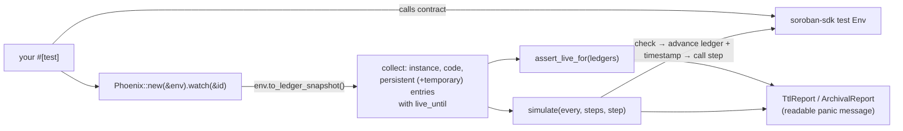

# Phoenix (`phoenix-ttl`)

**TTL-safety tests for Soroban contracts: prove in `cargo test` that your contract keeps its own state alive.**

[](https://github.com/Ike-Nathan/phoenix-ttl/actions/workflows/ci.yml)
[](LICENSE)

Every Soroban ledger entry has a time to live (TTL). When a contract instance, its Wasm code or a persistent storage entry runs out, it is **archived** and must be restored, with fees, before anyone can use it again. Temporary entries are **deleted**. Contracts are expected to manage this themselves by calling `extend_ttl`. But since protocol 23, the Rust SDK's test environment **restores archived entries automatically** and silently, so a contract that never extends a single TTL still passes every unit test. Phoenix makes TTLs a tested property: one line asserts that everything your contract owns stays live for a given time, and a simulation runs a usage pattern over months of ledgers and stops at the exact step where state would be lost.

```text
phoenix-ttl: 2 entries will not stay live for 518400 ledgers (≈ 30.0 days) from ledger 0:
  CAAA…HK3M  instance  contract instance  live until 4095  archived at ledger 4096 (in 4096 ledgers, ≈ 5.7 hours)
  CAAA…HK3M  code      wasm 36cb30a1…     live until 4095  archived at ledger 4096 (in 4096 ledgers, ≈ 5.7 hours)
How to fix:
  - instance/code: call env.storage().instance().extend_ttl(threshold, extend_to) in your entry points (it extends both).
  On a real network, archived entries must be restored (paying fees) before use; see https://developers.stellar.org/docs/learn/fundamentals/contract-development/storage/state-archival
```

_Above: the real test failure from the [example vault](examples/vault) with its `instance().extend_ttl` call removed._

## The problem

- **Tests can't see archival any more.** The SDK's own [migration note](https://docs.rs/soroban-sdk/latest/soroban_sdk/_migrating/v23_archived_testing/index.html) says that since protocol 23, reading an archived entry in a test succeeds, because the test host emulates automatic restoration. Its recommendation is to "explicitly verify the expected entry TTL" in tests. Phoenix does that for every entry at once.
- **Forgetting is easy and expensive.** Missing `extend_ttl` on the instance, or on a per-user key, makes users pay restoration fees, and transactions not built through simulation fail outright. Temporary data is lost for good.
- **TTL policy is a design decision that nobody writes down.** "Idle users' balances archive after 60 days" is a valid choice. Phoenix lets you state it as a test, so a refactor can't change it by accident.
- **Existing TTL tools watch deployed contracts.** Several monitors and keepers exist for deployed contracts, but they only warn you once the contract is live. Phoenix runs in `cargo test`, before the contract ships.

## How it works



Phoenix reads the test environment's ledger state with `Env::to_ledger_snapshot()`. It maps each Wasm code entry to the contracts whose instance uses it. It compares every entry's `live_until` with the ledger you care about. In a simulation, it checks **before** moving the ledger forward, so a failure names the step at which state would be gone. Details: [docs/how-it-works.md](docs/how-it-works.md).

## Quick start

Run the example from a fresh clone (needs Rust 1.91 or later):

```sh
git clone https://github.com/Ike-Nathan/phoenix-ttl && cd phoenix-ttl
cargo test -p phoenix-example-vault -- --nocapture
```

In your contract crate:

```toml
[dev-dependencies]
phoenix-ttl = { git = "https://github.com/Ike-Nathan/phoenix-ttl", tag = "v0.1.0" }
```

```rust
use phoenix_ttl::{days, Phoenix};

#[test]
fn state_outlives_a_month_of_inactivity() {
    let env = Env::default();
    let id = env.register(MyContract, ());
    let client = MyContractClient::new(&env, &id);
    client.deposit(&user, &100);

    Phoenix::new(&env).watch(&id).assert_live_for(days(30));
}

#[test]
fn weekly_use_keeps_the_contract_alive_for_a_year() {
    // ... setup as above ...
    Phoenix::new(&env)
        .watch(&id)
        .assert_survives(days(7), 52, |_env, _week| {
            client.deposit(&user, &1);
        });
}
```

## API reference

| Item | What it does |
| --- | --- |
| `Phoenix::new(&env)` | Start a checker for a test `Env`. |
| `.watch(&contract)` | Only check entries owned by this contract (repeatable). Without it, every contract in the `Env` is checked. |
| `.include_temporary(true)` | Also check temporary entries (off by default, because they are meant to expire). |
| `.seconds_per_ledger(n)` | Ledger close time used for time estimates and for advancing timestamps (default 5). |
| `.entries()` | Watched `TtlEntry` values (`kind`, `contracts`, `key`, `live_until`), soonest-expiring first. |
| `.report()` | Printable `TtlReport` of all watched entries. |
| `.check_live_for(ledgers)` / `.assert_live_for(ledgers)` | Every watched entry must have at least `ledgers` left. |
| `.simulate(every, steps, f)` / `.assert_survives(every, steps, f)` | Repeat `steps` times: check nothing expires in the next `every` ledgers, advance the ledger and timestamp, call `f(&env, step)`. Returns `Survival` or `ArchivalReport`. |
| `days(n)`, `hours(n)`, `weeks(n)` | Ledger counts at 5 s per ledger (`days(1)` = 17,280). |

Full reference: [docs/api.md](docs/api.md), and rustdoc via `cargo doc --open`.

## Status and limitations

Phoenix is **v0.1**. It works on its own tests and the example, and has not yet been used on large production contracts.

- **Targets soroban-sdk 29.0.1** (protocol 29) and needs Rust 1.91 or later, as the SDK does. Cargo resolves any 29.x SDK in your project to the same version. Other major SDK versions are not supported yet.
- **The test environment's TTL limits are not the network's.** A default `Env` uses a minimum persistent TTL of 4,096 ledgers and a maximum of 6,312,000. Real networks use different values that change through upgrades. If your contract depends on them, set them on the test ledger with `env.ledger().set_min_persistent_entry_ttl(…)` and related setters, using the [current network settings](https://developers.stellar.org/docs/networks/resource-limits-fees).
- **Time conversions are estimates.** `days()` and the report's "≈" values assume 5-second ledgers. Real close times vary.
- **Simulations only cover what you simulate.** A passing `assert_survives` means "this usage pattern keeps state alive", not "state can never be archived".
- **Code entries of natively registered contracts** (`env.register(Contract, ())`) are test stand-ins, not your real Wasm. Their TTL behaviour matches, because `instance().extend_ttl` extends both.
- Auth nonce entries are ignored. Accounts and trustlines have no TTL and are not reported.

## Roadmap

- Network presets: load real TTL limits for testnet and mainnet into the test ledger.
- Rent estimates: the fee cost of the extensions a simulation performs.
- Machine-readable report (JSON) written to `target/phoenix-ttl/`, so CI can track TTL margins over time.
- Support for more soroban-sdk major versions behind feature flags.
- Publish to crates.io.

See the [open issues](https://github.com/Ike-Nathan/phoenix-ttl/issues).

## Documentation

- [Architecture](docs/architecture.md)
- [API and configuration reference](docs/api.md)
- [How it works](docs/how-it-works.md): TTL rules, what Phoenix checks and when
- [Adding a check or report format](docs/extending.md)
- [Releasing](docs/releasing.md)

## Contributing

Please read [CONTRIBUTING.md](CONTRIBUTING.md) and wait to be assigned before starting an issue. This project follows the [Contributor Covenant](CODE_OF_CONDUCT.md). Report vulnerabilities as described in [SECURITY.md](SECURITY.md).

## License

[Apache-2.0](LICENSE)
