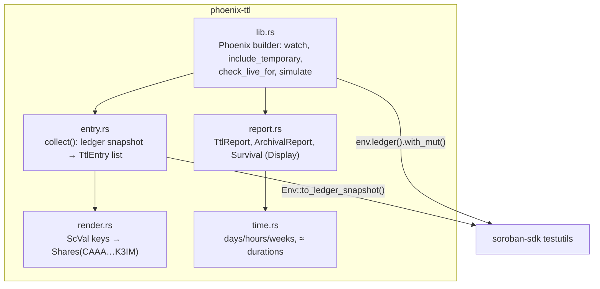

# Architecture

Phoenix is a single Rust library crate, `phoenix-ttl`, meant to be used as a **dev-dependency**. It depends only on `soroban-sdk` with the `testutils` feature.

| Module      | Responsibility |
| ----------- | -------------- |
| `lib.rs`    | The public `Phoenix` type. Filtering (watched contracts, temporary entries), the live-for check and the simulation loop. |
| `entry.rs`  | `collect(env)`: reads the environment's ledger snapshot and returns one `TtlEntry` per contract instance, contract data entry and contract code entry. It maps each code entry to the contracts whose instance uses that Wasm hash. Skips auth nonces and entries without a TTL. |
| `render.rs` | Short, readable storage keys and addresses for reports. Falls back to the XDR debug form for value types it doesn't know. |
| `report.rs` | Failure and status reports. Their `Display` output is the panic message users see, so it states what is lost, when, and how to fix it. |
| `time.rs`   | Ledger and time conversions at a fixed 5 seconds per ledger. |

## Design decisions

- **Read state, don't intercept the host.** Phoenix only uses public testutils APIs (`to_ledger_snapshot`, `ledger().with_mut`). It works with any contract and test setup and doesn't change contract behaviour.
- **Check before advancing.** The SDK test host restores archived entries silently. If Phoenix advanced the ledger first, an expired entry would be restored on its next access and the evidence would be gone. Checking before each step catches it at the right moment.
- **Fail loudly with a fix.** Assertions panic with the full report, using `#[track_caller]` so the location points at the user's test. `check_*` and `simulate` return `Result` for users who want to assert on the details.
- **Conservative defaults.** Temporary entries are excluded (they are meant to expire). Watching nothing means watching everything, so a forgotten `watch` errs towards more checking, not less.
- **No runtime cost to contracts.** Phoenix is only in `[dev-dependencies]` and is never compiled into Wasm.
